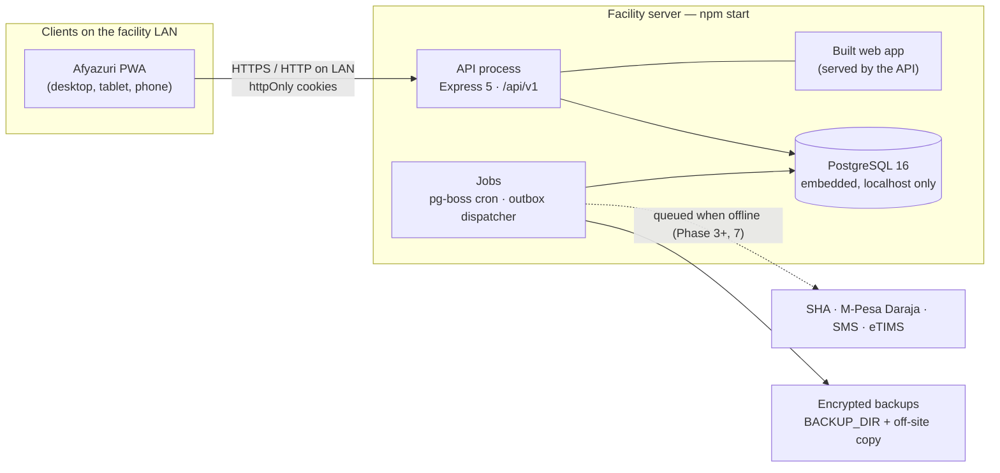
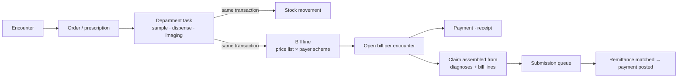

# Afyazuri architecture

## Shape of the system

Afyazuri is a **modular monolith**: one Node.js process (Express 5) and one PostgreSQL 16 database, plus a React PWA. On a facility server the whole system is a single `npm start`. That command runs an embedded PostgreSQL bound to localhost, and an API that also serves the built web app. No Docker, Redis or separate web server is required.



## Modules

Each domain module under `apps/api/src/modules/<name>/` owns its routes, service and data access, and its tests live in `apps/api/test/`. Modules call each other only through **service functions** or **domain events**, never by querying another module's tables.

| Module                   | Phase | Responsibility                                                      |
| ------------------------ | ----- | ------------------------------------------------------------------- |
| `auth`                   | 1     | Login, sessions, refresh-token rotation, TOTP, facility switching   |
| `users`                  | 1     | Staff accounts, scoped role assignments, disable/force-logout/reset |
| `facilities`             | 1     | Facilities, departments, service points, wards, beds, settings      |
| `audit`                  | 1     | Append-only audit writer, viewer, CSV export                        |
| `health`                 | 1     | `/health`, `/ready`, `/metrics`                                     |
| `patients`, `emr`, `opd` | 2     | Registration, duplicates, merge, EMR, queues                        |
| `billing`                | 3     | Price lists, auto-posted charges, payments, receipts, shifts        |
| `pharmacy`, `inventory`  | 4     | Dispensing (FEFO), stock ledger, requisitions, GRNs                 |
| `lab`, `imaging`         | 5     | Orders, samples, results, verification, reports                     |
| `ipd`                    | 6     | Admissions, bed board, MAR, daily charges, discharge                |
| `claims`                 | 7     | Payer adapters (SHA, private), preauth, claims, remittances         |
| `reports`                | 8     | Materialized views, dashboard, MOH outputs                          |
| `sync`                   | 9     | Delta sync for offline clients                                      |
| `notifications`          | 3+    | In-app and SMS (adapter, mocked by default)                         |

Shared code in `packages/shared` holds the Zod schemas, enums and the permission catalogue. Both the API (validation and authorization) and the web app (forms and UI gating) use it, so the two never disagree.

## Request pipeline

```
request → request id + pino log (query strings stripped) → helmet (CSP) → compression → strict CORS
        → JSON body (1 MB cap) → cookies → /health,/ready,/metrics
        → /api/v1: CSRF header guard → no-store → module router
              → authenticate (cookie JWT → live session → active user → grants)
              → requirePermission(...) → validate(Zod) → [idempotency] → service (transaction + audit)
        → error handler → { error: { code, message, details } }
```

## Identity, sessions and authorization

- **Passwords:** Argon2id (19 MiB, t=2, p=1). Policy: at least 10 characters, with upper and lower case, a digit and a symbol, and not containing the username. Accounts lock after 5 failed attempts for 15 minutes; an admin can unlock them. Login timing is equalised for unknown usernames.
- **Tokens:** a 10-minute HS256 access JWT holds only `sub` and `sid`. An opaque refresh token is valid for 8 hours and capped at the 7-day session lifetime. Both live in `httpOnly`, `SameSite=Strict` cookies, `Secure` in production. The refresh cookie is scoped to `/api/v1/auth`. Only the SHA-256 of a refresh token is stored.
- **Rotation and theft detection:** each refresh marks the old token used and issues a child token. If a used token is presented again, the whole session is revoked and a `token_reuse` audit entry is written.
- **Live checks:** every request re-reads the session, the user and their grants. So disabling a user, a force logout, a role change or the idle timeout (15 minutes by default) takes effect on the next request, not when the token expires.
- **CSRF:** state-changing requests must carry `X-Afyazuri-Client: 1`. Browsers can't add that header cross-origin without a CORS preflight, and the strict CORS policy refuses those preflights.
- **2FA:** TOTP (RFC 6238). The secret is stored encrypted. `REQUIRE_2FA_PRIVILEGED=true` blocks admin and finance roles until they enrol.
- **Authorization:** permissions are strings like `billing.waiver.approve`, granted to roles. A user's role assignment (`user_roles`) names a facility, or none for deployment-wide access, and optionally one department. `requirePermission` checks the grant at the session's active facility and, when the route names a department, that department. The API is the source of truth; the UI only hides what the user can't use. See the [permission matrix](permission-matrix.md).
- **Facility isolation:** facility-scoped data is always read and written through the session's active facility, so another facility's records return 404. Composite foreign keys such as `(facility_id, encounter_id)` stop cross-facility links in the database itself.

## Data layer

- PostgreSQL 16 with Knex migrations. Primary keys are `uuid` (`gen_random_uuid()`), timestamps are `timestamptz` and money is `numeric(14,2)`.
- Every business table has `facility_id`, `created_at`/`updated_at` (maintained by a trigger) and `created_by`/`updated_by`.
- **Clinical records are never hard-deleted.** Mistakes are marked entered-in-error with a reason. Signed notes are locked by a trigger, and changes go into append-only addenda.
- **Audit log:** an append-only table. UPDATE, DELETE and TRUNCATE raise errors in triggers, and the `afyazuri_app` role has those privileges revoked. Each entry records the actor, roles, facility, action, entity, patient, before/after values, a field diff, IP, user agent and request id. Secrets are redacted before writing.
- **Sensitive fields:** phone numbers, national IDs and other identifiers are encrypted at the application layer with AES-256-GCM and a versioned ciphertext (`v1:`). A keyed HMAC "blind index" allows exact-match search without decrypting.
- **Fuzzy search:** a `pg_trgm` GIN index on the generated `patients.search_name` column powers duplicate detection and name search (Phase 2).

## Events and background work

```
service ──(same transaction)──► outbox_events ──► dispatcher (1 s poll, SKIP LOCKED) ──► subscribers
                                                   retries with exponential backoff, 8 attempts
```

- **Transactional outbox:** an event is written in the same transaction as the change that caused it. So an event exists exactly when its change committed, and delivery survives restarts. Handlers must be idempotent, because delivery is at-least-once.
- **pg-boss** (backed by Postgres, no Redis) runs scheduled jobs: session and idempotency-key cleanup, nightly backups and, in later phases, daily bed charges, claim retries and materialized-view refreshes.
- **Idempotency keys:** `Idempotency-Key` on unsafe requests stores the first response and replays it for repeats. Payments, dispensing, claim submission and offline-synced writes will require it.

## Order → charge → claim flow (Phases 3–7)



Staff never re-key data between departments. Every billable clinical action posts a charge to the encounter's open bill, resolved against the facility price list and the patient's payer scheme.

## Offline and sync design (Phase 9)

The groundwork is already in the schema. Triggers record every insert, update and delete on syncable tables in `sync_changes`, whose `bigserial` id is a monotonic server change sequence. Offline-capable tables also have a unique `client_id` so client-generated UUIDs make writes idempotent.

- **Pull:** the client asks for changes after its last sequence number (by facility), cursor-paginated.
- **Push:** the client sends outbox writes keyed by `client_id`. Repeats are no-ops.
- **Conflicts:** last write wins for simple fields. Clinical notes, vitals and payments are append-only and so never conflict. Genuine conflicts are shown to the user.
- **PWA:** a Workbox service worker caches the app shell today. Phase 9 adds IndexedDB reference data and a write outbox.

## Deployment modes

| Mode             | Database                                                    | TLS                                                              | Start                                             |
| ---------------- | ----------------------------------------------------------- | ---------------------------------------------------------------- | ------------------------------------------------- |
| Development      | embedded, `.pgdata/`                                        | none                                                             | `npm run dev`                                     |
| On-premise (LAN) | embedded, `data/postgres/`, localhost only                  | `TLS_CERT_FILE`/`TLS_KEY_FILE` or plain HTTP behind the firewall | `npm start` via systemd or a Windows startup task |
| Cloud            | embedded, or managed PostgreSQL via `EXTERNAL_DATABASE_URL` | Nginx + Let's Encrypt (`deploy/nginx`)                           | `npm start`                                       |
| CI               | throwaway embedded instance per test run                    | —                                                                | GitHub Actions                                    |
